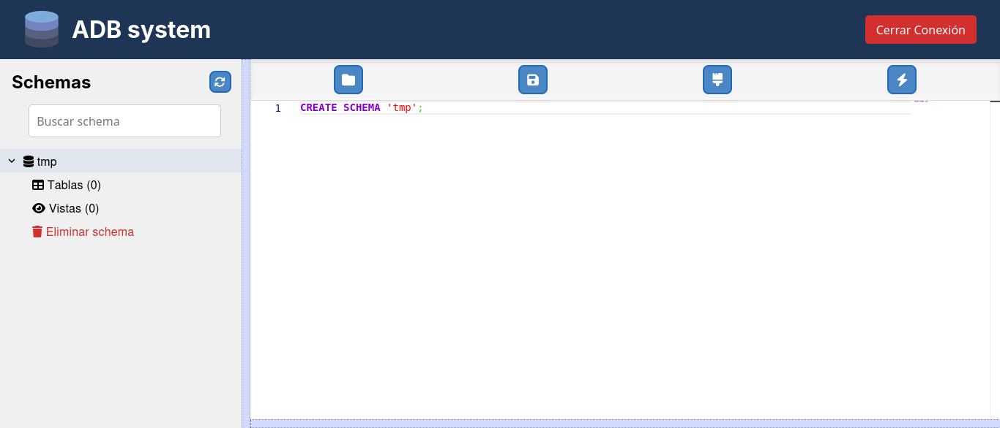
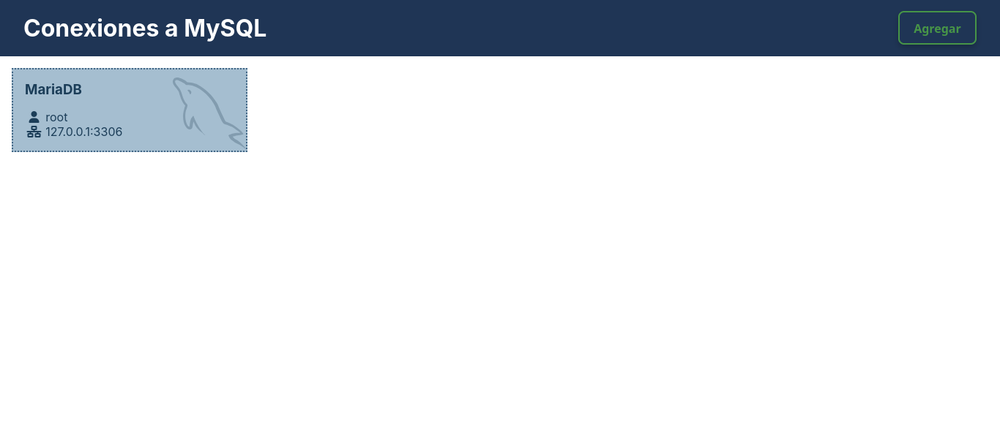
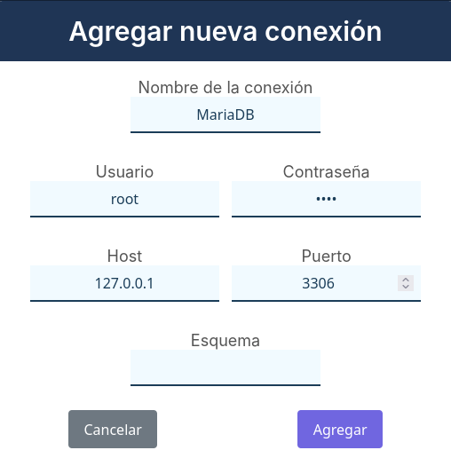
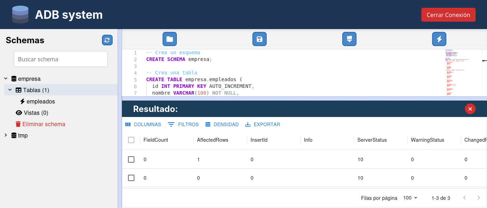

# ADB — Administrador de bases de datos

**Proyecto amateur de desarrollo web | En etapa experimental**

ADB es un proyecto personal de aprendizaje orientado a la administración visual de bases de datos. Busca ofrecer una interfaz gráfica para consultar conexiones, visualizar información y ejecutar consultas SQL sin depender exclusivamente de la terminal.

Este proyecto fue desarrollado como una práctica de programación y todavía presenta numerosos errores y limitaciones. No es una herramienta terminada ni está preparado para utilizarse en entornos de producción.

## Capturas de pantalla

### Interfaz principal

<p align="center">
  
</p>

### Conexiones

<p align="center">
  
</p>

### Configuración de conexión

<p align="center">
  
</p>

### Consultas SQL

<p align="center">
  
</p>

## Características previstas

- **Interfaz gráfica:** administración de bases de datos mediante una interfaz web.
- **Gestión de conexiones:** interfaz para configurar y consultar conexiones a bases de datos.
- **Consultas SQL:** espacio de trabajo para escribir y ejecutar consultas.
- **Visualización de información:** presentación de datos mediante componentes de interfaz.
- **Arquitectura full-stack:** separación entre la interfaz web y el servidor.

La disponibilidad y el funcionamiento de cada característica pueden variar según el estado actual del código.

## Tecnologías

- **JavaScript:** desarrollo de la aplicación.
- **React:** construcción de la interfaz de usuario.
- **Node.js:** entorno de ejecución del servidor.
- **Express:** desarrollo del backend y sus rutas.
- **MySQL:** tecnología de base de datos prevista para el proyecto.

## Estado del proyecto

**Experimental y con errores conocidos.**

ADB es un proyecto amateur, desarrollado principalmente para practicar conceptos de programación y desarrollo web full-stack.

El código contiene numerosos errores, comportamientos inconsistentes y aspectos que necesitan mejoras. Algunas funciones pueden no funcionar como se espera y la experiencia de uso no es necesariamente estable.

Este repositorio se publica como muestra del proceso de aprendizaje y de una implementación temprana, no como una solución profesional lista para utilizarse.

## Requisitos

Para intentar ejecutar el proyecto, necesitarás:

- Node.js y npm.
- Un servidor de base de datos compatible con la configuración implementada.
- Los archivos de configuración y dependencias del repositorio.

Las versiones requeridas y la configuración exacta dependen de los archivos actuales del proyecto.

## Instalación

### 1. Clonar el repositorio

```bash
git clone https://github.com/RAH-013/ADB.git
cd ADB
```

### 2. Instalar las dependencias

Revisa los archivos `package.json` del repositorio para identificar los directorios de la aplicación y del servidor. En cada directorio que tenga su propio `package.json`, instala las dependencias:

```bash
npm install
```

### 3. Configurar la base de datos

Configura las credenciales y los parámetros de conexión que requiera la implementación actual. Consulta los archivos de configuración del proyecto antes de iniciar el servidor.

No publiques contraseñas, credenciales ni archivos `.env` con información sensible.

### 4. Ejecutar la aplicación

Consulta los scripts definidos en cada `package.json` para conocer los comandos disponibles para iniciar el frontend y el backend. Los comandos concretos pueden variar según la estructura del repositorio.

## Limitaciones y advertencias

- El proyecto contiene numerosos errores y no garantiza un funcionamiento correcto.
- La gestión de conexiones y la ejecución de consultas pueden presentar fallos.
- La validación de entradas, el manejo de errores y la estabilidad general pueden ser incompletos.
- No se garantiza la compatibilidad con diferentes versiones de servidores de bases de datos.
- No se recomienda utilizarlo con bases de datos de producción ni con información importante.
- No debe asumirse que dispone de controles de seguridad suficientes para proteger credenciales o restringir consultas peligrosas.

**Utilízalo únicamente en entornos de prueba y con datos que puedas permitirte perder.** Antes de ejecutar consultas, verifica sus efectos y conserva copias de seguridad de cualquier información que te interese.

## Objetivos de aprendizaje

Este proyecto representa una práctica de desarrollo full-stack enfocada en:

- Construir interfaces con React.
- Comunicar un frontend con un backend.
- Trabajar con Node.js y Express.
- Explorar la conexión a bases de datos relacionales.
- Implementar interfaces para consultas SQL.
- Identificar errores y reconocer áreas de mejora en un proyecto propio.

## Mejoras pendientes

El proyecto necesita trabajo adicional en aspectos como:

- Corrección de errores y comportamientos inesperados.
- Validación de entradas y manejo de excepciones.
- Gestión segura de conexiones y credenciales.
- Mejoras en la interfaz y la experiencia de usuario.
- Pruebas para verificar el funcionamiento de las operaciones principales.
- Documentación técnica de la instalación y configuración.

Esta lista describe áreas de mejora, no funcionalidades que ya estén implementadas.

## Autor

**RAH-013**

- [Repositorio de GitHub](https://github.com/RAH-013/ADB)
